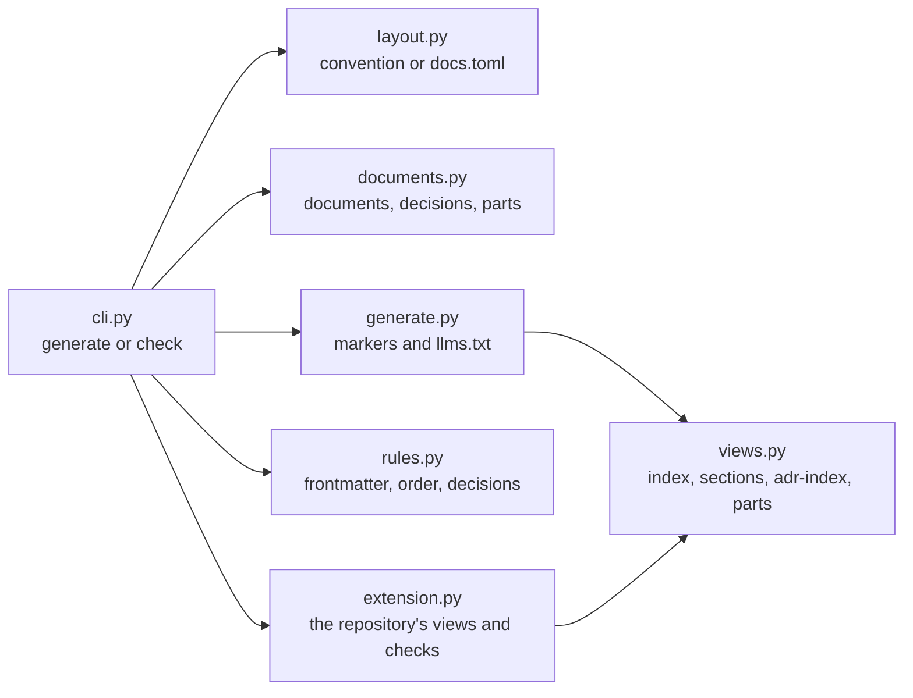

# The documentation generator

Validates a repository's documentation and generates the views derived from it. How to run it is in its
help: `uv run documentation --help`. This page is for changing it.

## How the parts connect
The command reads the layout, finds every document, loads the repository's extension if it has one,
checks the rules, then renders every generated view and `llms.txt`.

| Module | Does |
|---|---|
| `cli.py` | The command line, and the order: layout, documents, extension, rules, rendering |
| `layout.py` | Where documentation is: the convention, or what `docs.toml` overrides |
| `documents.py` | Finding documents, decisions and part READMEs, and reading their frontmatter or heading |
| `rules.py` | The rules: frontmatter against `schemas/`, reading order, section READMEs, decision numbers |
| `generate.py` | Rendering the views between markers, and `llms.txt` |
| `views.py` | The views every repository can use, and helpers for a repository's own views |
| `extension.py` | Loading a repository's own views and checks from the file `docs.toml` names |
| `report.py` | The problems found, reported together at the end |

## Extending it
- **A view or rule for every repository:** add it to `views.py` or `rules.py`, with a test in `tests/`.
- **A view or rule for one repository:** put it in that repository's extension, named in its `docs.toml`
  (`extension = "scripts/docs_views.py"`). The file may define `VIEWS`, `load(root, error)` and
  `validate(context, error)`; see `extension.py`. A view receives its marker's argument as `folder`,
  plus `root`, `documents`, `decisions`, `readmes` and whatever `load` returns.
